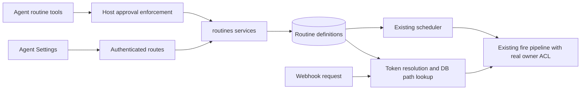

# DB-backed routines

Date: 2026-10-09. Status: design and implementation plan approved; Tasks 1–11 implemented on `codex/db-backed-routines`. Task 12 validation and kind acceptance are complete; final independent task/branch review is pending. This is not a production deployment claim.

Worktree: `/Users/vpulim/dev/ai/ax-next-db-routines`; branch: `codex/db-backed-routines`, based on `origin/main` at `a730c4c6e`.

## Current shape — TASK-970, 2026-10-26

The original design below records the exclusive `trigger` contract. TASK-970
replaces that authored field with independent nullable `schedule` and `webhook`
fields, in the shared contract, host tools, services, Settings and stored views.
A Repeat job needs at least one and may use both. Stay-on-top and get-done tasks
still require a schedule and cannot receive app updates until PR 5.

Migration 15 preserves routine IDs, revisions, webhook paths and configuration,
credential references and completed operation receipts. A legacy `trigger` input
still means an exclusive replacement; canonical patches preserve omitted methods
and remove a method with explicit `null`. Default catalog APIs remain a separate,
interval-only `trigger` DTO, adapted when edited or materialized.

New or changed Repeat schedules have a 60-second floor, including custom cron.
Saved faster cron schedules keep working and survive unrelated edits and completed
receipt replay. Task schedules keep their 15-minute floor. Work hours constrain
scheduled runs; Repeat webhook arrivals run when they arrive. Legacy inputs retain
their 65,536-byte bound; canonical definitions and patches have one 65,552-byte
bound, including the fixed 16 bytes added by method normalization.

The receiver bearer stays restricted to the agent's existing setup authority. A
read-only access check lets the editor distinguish an administrator-needed setup
from an unavailable service without reading or creating a token. This note
describes TASK-970's implementation, not a production deployment.

## Intent and agreed decisions

Chat and Agent Settings must manage the same durable routine definition. A successful change becomes available to the scheduler and webhook receiver without a workspace commit. A routine runs unattended as a real human owner, so creating one must be an explicit host capability.

The DB is the only definition source. Remove file synchronization, routine markdown serialization, and `@ax/validator-routine` in the same change. Keep interval, cron, webhook, active hours, silence handling, shared/per-fire conversations, fire-now, history, Activity, and existing default routines working.

The user has settled these choices:

- Agent creates and edits require approval by default, including webhook routines and calls during a user turn.
- **Allow** approves the proposed operation once. **Always Allow** approves it and future routine creates/edits for **this agent only**. The grant is durable and revocable.
- Do not import existing authored routines. Delete them, their associated history and HMAC credentials, and their workspace files. This supersedes the original field-preserving import requirement. Keep default routines and their history.
- Updates are patches with revision checks. Omitted fields stay unchanged; `null` clears optional fields; `trigger` and `activeHours` replace complete objects.
- Use a short system instruction alongside tool descriptions. Read current definitions through tools instead of embedding them in the prompt.

The user approved the ACL and retirement behavior below, reviewed the implementation plan, and selected subagent-driven execution. The final validation record documents the implemented refinements and completed evidence.

Out of scope: goals, identity files, workspace-store retirement, multi-host scheduling, and `.ax/skill-reflection/last-run.json`.

## Evidence from the current code

- `routines_v1_definitions` keys on `(agent_id, path)`. `routines_v1_fires` and shared conversation external keys carry that path. HMAC refs use `routine:${agentId}:${path}:hmac`.
- `sync.ts` already stores every authored field: trigger JSON (including webhook events/HMAC), active hours, silence token/max, conversation mode, prompt body, and owner. Nothing needs importing under the revised scope.
- Ownership is already insert-only for team routines, with personal owners reconciled by the tick. Every fire calls `agents:resolve` with a real human; a synthetic actor would break the ACL.
- `plugin.ts` mounts individual webhook routes and keeps them in a process-local map. `agents:resolve-by-webhook-token` exists but is not used by this routing path.
- Default definitions live in `default_routines_v1`; runtime materializations live in `routines_v1_definitions` with `definition_id`. Default runtime identities are `default:<defaultRoutineId>` within an agent. Preserve these opaque values to retain their conversation/history associations.
- Default edit transport still accepts `sourceMd`, and the default catalog stores it alongside all parsed fields. Removing the parser therefore requires structured default-editor transport too; it does not require redesigning default scheduling.
- Routine Settings writes go through `workspace:apply`, so workspace quotas and commit timing affect routine edits. Public apply now emits `workspace:applied`; the older memory note saying otherwise is superseded.
- Host tools register through `tool:register` and `tool:execute:<name>`, as demonstrated by `memory_recall`. Their service results cross the existing host-tool IPC endpoint.
- IPC redacts ordinary `PluginError` messages. Returning an error object instead is also insufficient: approval replay currently treats any returned value as successful execution. Expected validation failures need an explicit safe failure contract.
- `tool.pre-call` and `tool.execute-host` are separate requests. Routine effects must enforce approval at execution, not rely solely on the runner having made the first request.

Relevant memory: TASK-397 ownership, TASK-680 deleted-agent detection, TASK-718 scoped purge, TASK-719 quota behavior, and the `agents:resolve` prohibition on synthetic actors.

## Approach

Use the existing routine store and scheduler, change the identity and definition interfaces, and add structured service/tool adapters. Keep default catalog materialization and its overrides.

Alternatives within the settled DB-only architecture:

| Approach | Tradeoff |
| --- | --- |
| Evolve the existing store and scheduler (recommended) | Preserves tested fire/silence/default behavior; concentrates changes on authority, identity, interfaces, and routing. |
| Replace the runtime schema and scheduling pipeline | Cleaner naming initially, but duplicates default materialization and fire bookkeeping and creates more regression opportunities. |
| Collapse authored and default catalogs into one new model | Removes some distinctions but redesigns defaults outside the requested slice. |

Add a pure `@ax/routines-contract` library for schemas, types, and validation shared by host services and the web client. It is not a plugin: no registrations, DB access, credential access, or process state. Cron validation uses the existing pinned Croner dependency. Move duration parsing and trigger validation out of the removed validator package. Plugin implementations communicate only through hooks.



## Definition, identity, and validation

An authored definition has these editable fields:

```ts
type RoutineDefinition = {
  name: string;
  description: string;
  promptBody: string;
  enabled: boolean;
  trigger:
    | { kind: 'interval'; every: string }
    | { kind: 'cron'; expr: string; tz: string }
    | {
        kind: 'webhook'; path: string; events?: string[];
        hmac?: { header: string; algorithm: 'sha256' | 'sha1'; prefix?: string };
      };
  activeHours: { start: string; end: string; tz: string } | null;
  silenceToken: string | null;
  silenceMaxChars: number;
  conversation: 'per-fire' | 'shared';
};
```

Create defaults: enabled `true`, description empty, activeHours/silenceToken `null`, silenceMaxChars `300`, conversation `per-fire`, HMAC algorithm `sha256` if omitted within HMAC. Name is a human label, not a filename or slug. Preserve prompt text as submitted, including newlines.

Host-generated `routineId` is stable across renames and trigger changes; new authored IDs use `rtn_<32 hex>`. Identity remains `(agentId, routineId)` so existing default identities need no re-keying. IDs and revisions are opaque to consumers. Rename the internal `path` columns and public fields to `routine_id`/`routineId`. A webhook's `trigger.path` is an HTTP path and remains part of the trigger.

Each definition has an opaque `revision`, changed by definition edits and ownership changes, not by fires or last-status updates. Runtime status is separate. Return revision on list/get/create/update. Read projections exclude raw owner IDs, spec hashes, HMAC secret values, credential refs, and receiver bearer tokens; they include explicit caller permissions. Return dates consistently as ISO strings on the public contract.

Validation is strict at the service boundary, after applying a patch to the latest complete definition. Reject unknown fields, protected fields, empty patches, malformed nested objects, and payloads exceeding 64 KiB encoded as UTF-8. Bound name to 128 characters, description to 2,048, and cron expression to 256; reserve the overall limit for instructions. Bound silence token and HMAC prefix to 128 characters and header to 128 RFC-token characters. Silence max is an integer from 0 through 65,536. Do not include submitted content in error messages.

- Intervals retain `s/m/h/d`, minimum 60 seconds; reject overflow and durations that cannot yield a valid next date.
- Cron uses Croner parsing and validates IANA timezone names. Preserve existing engine scheduling semantics.
- Webhook paths start with `/`, are at most 128 characters, and use the existing ASCII path character set. Reject reserved `/webhooks/` prefix, empty/dot/dot-dot segments, double slashes, percent escapes, query/fragment delimiters, and ambiguous trailing slashes. No decoding aliases.
- Event filters retain up to 32 names, each 1–64 ASCII letters/digits/underscore/hyphen. Preserve the existing `X-GitHub-Event` matching semantics, including behavior when the header is absent.
- Active hours retain timezone, overnight windows, and existing quiet-period scheduling. Reject them for webhook triggers. Permit `24:00` only as an end boundary.
- HMAC options configure verification. The host derives the credential destination from the agent and stable routine ID; callers cannot select another credential or supply a secret through a routine tool.

Enforce webhook-path uniqueness with a DB unique index on `(agent_id, trigger_spec->>'path')` for webhook definitions. It covers enabled and disabled routines, so enabling cannot unexpectedly steal a path. A competing insert/update fails atomically with `webhook-path-conflict`; it does not partially change the routine. The same path may exist on different agents because their receiver tokens differ.

## Services, tools, and Settings routes

All public routine services validate and authorize independently of their callers. Scoped reads require `agentId`; remove the unscoped all-routines read. Activity obtains visible agents through agent hooks and makes scoped calls with the authenticated person's context.

| Hook | Input | Result |
| --- | --- | --- |
| `routines:list` | `{ agentId }` | Caller-visible definitions/status, IDs, revisions, permissions. |
| `routines:get` | `{ agentId, routineId }` | Complete caller-visible definition/status or not-found. |
| `routines:create` | `{ agentId, requestId, definition }` | Created definition, ID and revision. |
| `routines:update` | `{ agentId, routineId, expectedRevision, patch }` | Updated definition and revision. |
| `routines:delete` | `{ agentId, routineId, expectedRevision }` | Deleted result and credential-cleanup status. |
| `routines:fire-now` | `{ agentId, routineId, expectedRevision, requestId }` | Existing dispatch verdict; final status comes from history. |
| `routines:recent-fires` | `{ agentId, routineId, limit? }` | Scoped fire history, without storage row IDs. |
| `routines:recent-fires-for-agent` | `{ agentId, limit? }` | Scoped Activity fire history. |
| `routines:set-webhook-secret` | `{ agentId, routineId, expectedRevision, secret }` | Human-only credential write confirmation, never the secret. |

Create/fire request IDs identify a logical request and must be reused on retries. A durable same-plugin request receipt keyed by agent, real actor, operation, and request ID prevents duplicate creates/dispatches. Matching retries return the stored result; a different payload with the same request ID conflicts. Retain receipts after routine deletion so an old approved create cannot resurrect it. Purge receipts with the agent. No process-local deduplication map.

Patch keys are exactly the editable definition fields. `null` clears `activeHours` and `silenceToken`; other required fields cannot be cleared. Optional trigger fields are cleared by supplying a replacement trigger without them. CAS and uniqueness checks run in the mutation transaction. A stale update/delete/fire-now fails with `revision-conflict`. Return a safe instruction to get the routine again; do not silently rebase the approved patch onto a Settings edit.

Register `routine_list`, `routine_get`, `routine_create`, `routine_update`, `routine_delete`, and `routine_fire_now` as `executesIn: 'host'`. Tools infer agent and actor from the authenticated execution context: they do not accept `agentId`, owner IDs, admin flags, execution source, or webhook payloads. Their strict schemas and descriptions live in the routines contract/tool modules. They do not flush or write the workspace. Get/list expose defaults for awareness, but authored CRUD cannot edit/delete a default materialization; direct the caller to default controls.

The REST adapter uses authenticated context and the same services: collection GET/POST, item GET/PATCH/DELETE, fire-now POST, and history GET under `/settings/routines/:agentId`. Items use opaque IDs. Map invalid input to 400, inaccessible/missing objects to a non-disclosing 404, revision/path/request conflicts to 409, and infrastructure failure to 5xx. Remove `{path, sourceMd}` endpoints and CAS workspace retry code. Human Settings edits are direct authorized actions and do not require a second approval card.

Default hooks retain their domain IDs and existing semantics. `get-default` returns canonical fields, not sourceMd. `upsert-default` takes those structured interval-only fields plus optional global enabled, retaining the existing catalog identity/upsert rules. Missing enabled preserves an existing default's flag. List/delete/default-override inputs retain their current domain fields; add service-side caller authorization and real web contexts. This slice does not add agent-tool access to global default administration.

### Expected errors must remain errors

Introduce a narrowly scoped safe tool failure subtype of `PluginError` in core. It survives HookBus's existing PluginError preservation. Its wire detail consists of a closed error code, bounded canonical field paths, and host-authored messages selected from reviewed templates. Never wrap arbitrary thrown messages or rejected values in it. Ordinary PluginError redaction remains intact.

The host-tool IPC handler recognizes only this subtype and transports safe details using its local error response schema. Both runners render it as a failed tool result with actionable validation/conflict detail. Approval replay catches it as failure and produces a failure receipt. A SQL exception, secret-bearing exception, or unknown plugin error stays generic. Tests cover each path and ensure no success receipt on failed mutation.

Before raising an approval, the routines plugin's `tool:pre-call` subscriber validates eligible calls using the same local validation/ACL helpers as its executor, including reading the merged candidate for an update. It runs before the decisions hold subscriber and returns a structured rejection for expected failures; it never throws to enforce a veto. Invalid proposals reach the model without making the human approve them first. Execution repeats validation/CAS because the world can change during approval. Direct host execution also validates before requesting effect authority. This is read-only preflight, not a pending runnable definition.

## Ownership and ACL

Ownership is host-derived and cannot be patched. Personal routines run as the agent's real owner; team routines run as the real creator and stay pinned to that person. Editing never transfers execution identity. The tick retains personal-owner reconciliation and `agents:resolve` before every fire. Team membership removal prevents execution; an authorization failure is recorded without deleting a live agent's definition. Only an exact not-found result means the agent is gone.

Proposed management policy:

| Actor | Read | Create | Edit / fire | Delete / disable |
| --- | --- | --- | --- | --- |
| Personal agent owner | Yes | Yes | Yes | Yes |
| Team admin who is still a member | Yes | Yes, owned by that human | Their own routines | Any team routine to stop unattended work |
| Ordinary team member | Yes | No | No | No |
| Someone without agent access | No | No | No | No |

A manager cannot change someone else's prompt or enable/fire their routine as that person. Disabling another owner's routine is a stop-only patch; enabling it requires its owner. Workspace-admin status alone does not grant another person's execution identity. Existing admin-only default-catalog management remains unchanged.

Add `agents:can-manage-routines` as the agent plugin's policy hook, implemented with its existing owner/team-role helpers. It accepts the real context actor, not a caller-provided `isAdmin`. Do not repurpose a connector-named hook. Extend webhook-token ensure/rotation authorization consistently for personal owners and team admins, retaining existing explicit workspace-admin management where that service already supports it. Possessing a token does not authorize routine management. Routine service access still uses the narrower policy above.

The web adapter must pass real authenticated context, not registration `initCtx`. Background execution obtains owners via trusted agent/routine data. No `system`, `routine:...`, or other fabricated user is passed to `agents:resolve`.

## Approval and agent-only Always Allow

Read tools are allowed after ACL validation. Create/update default to hold. Proposed delete/fire-now policy is also hold by default, with Allow once only; the create/update grant does not authorize either. Webhook creates/edits use the same approval rule as interval/cron.

Keep permission truth in `@ax/tool-policy`, in durable consent scoped to `(agentId, realUserId)`. It means this person permits this agent's create/update tools; it does not grant the agent other users' authority, default-catalog rights, credential access, or cross-agent management. The extra user binding prevents a new owner/team actor inheriting someone else's consent. No routine plugin permission table or replica-local permission map.

Default routine create/update rules explicitly support this consent exception to hold. Evaluate deny rules and current actor ACL first. Do not turn arbitrary existing hold/deny rules into allow with a blanket agent override. Missing policy/decisions providers and failed consent reads fail closed for tool mutations.

Approval cards have host-authored summaries of name, trigger, instructions, and affected agent. Updates show the changed fields and captured revision. Only server-validated create/update decisions expose **Always Allow**. The explanation reads: “Allow this change and future routine creates and edits by Caveman. Only this agent.” Keep dismiss and existing decision controls.

Extend `decisions:approve` with `approvalScope: 'once' | 'agent-routines'`, default once. Validate the authenticated approver, stored owner/agent, exact eligible tool, decision state, and current ACL. Never derive grant scope from model-authored input. Store the chosen scope and grant-delivery state with the decision claim. Deliver an idempotent `tool-policy:grant-routine-consent` before releasing execution; persist delivery completion. Recover unfinished delivery through the existing decisions sweep. On policy-write failure, report approval pending, do not execute or show a saved grant, and retry durably. A dismissed/expired decision cannot grant consent.

If consent saves but the particular edit fails a revision check, report both facts honestly: future create/edit permission saved, current edit failed. Do not undo deliberate blanket consent merely because one proposal became stale.

Add `tool-policy:get-routine-consent` and `tool-policy:revoke-routine-consent` for authenticated Settings. Revocation affects the next execution check without respawning a runner. Agent deletion purges consent through tool-policy's agent-deletion subscriber. Ownership changes cannot carry the grant to a different human.

### Enforce approval at the host effect

Routine mutation executors call a new `decisions:authorize-routine-call` service before calling routines services. It accepts the exact ToolCall and obtains actor/agent from context. It re-evaluates current deny policy and either verifies saved consent or atomically validates the matching approved decision's authority. The decision lookup binds agent, real owner, operation fingerprint, and expiry. Pre-call handling for these tools must leave final approval consumption to this host check; simply calling `tool.pre-call` does not confer mutation authority.

Host replay is authorized from its already-claimed stored decision, and attended execution is authorized from its standing approval. Neither accepts an approval flag from IPC. Concurrent retries are bound to the same logical request; CAS/idempotent receipts protect effects after approval consumption and transport failure. Failure after consuming approval requires a fresh proposal unless it is an exact retry of a recorded result. Generic pre-call approval behavior for other tools remains unchanged.

Keep claimed routine-execution authorization associated with the exact logical call in the decisions DB until its outcome is settled. This permits an exact transport/crash retry to reach the routine receipt; it does not authorize a new request. Test both crashes before the routine transaction and after its commit. Decisions owns authorization state, routines owns effect receipts, and neither plugin reads the other's rows. Preserve the documented dynamic host-tool dispatch exception in decisions; do not add a manifest dependency back from decisions to routines that creates a bootstrap cycle.

A direct `tool.execute-host` request with no approval/consent must fail, including when the sandbox omits pre-call or alters approved input. Human web routes call authorized services directly; arbitrary routines service hooks are not IPC actions exposed to the sandbox.

## Scheduler, Enabled, and fire lifecycle

Preserve the existing engines, claimDue, default materialization, pending fire correlation, silence finalization, and skipped-connector warning logic. Existing transient pending-turn bookkeeping is not a new definition/routing/permission cache.

Create schedules the first interval/cron occurrence after the save; it does not fire immediately. Webhooks become eligible when the enabled definition commits. Disabled definitions have no due claim, and their webhook requests do not dispatch. Explicit fire-now on a disabled routine is rejected; the human must enable it first. Disabling does not erase history or cancel an already accepted agent turn.

Prompt/name/description edits do not postpone a due run. Recompute nextRun only when trigger, active hours, or enabled state changes. Re-enabling computes a future occurrence and does not replay missed intervals. Preserve default enabled/override scheduling rules separately.

Claims carry the definition revision. Before accepting dispatch, re-read the current enabled definition and owner, validate the claim revision, and condition schedule advances on that revision. Serialize acceptance with edit/delete using DB row locking; do not hold a DB transaction across `agent:invoke`. Committing acceptance is the boundary: a subsequent edit/delete prevents later acceptances, while an already accepted run may finish. Never allow a stale claimed object to overwrite a new schedule or resurrect a deleted definition. Record the accepted definition revision with the fire for audit.

Fire-now always derives source `manual`. Only the internal webhook path supplies source/payload `webhook`. Retain the current dispatch-versus-final-status distinction and exactly-once silence/skip-warning completion tests. Activity resolves routine labels by stable ID and keeps a sensible deleted-routine fallback.

## Webhook routing and credentials

Register one static host route for `POST /webhooks/:token/*`. On every request:

1. Resolve the supplied token through `agents:resolve-by-webhook-token`.
2. Validate the remaining canonical HTTP path without permissive decoding.
3. Find the enabled webhook definition by agent and path in the DB.
4. Load the exact host-derived HMAC destination when configured, verify the raw body, parse the bounded body, and apply event filters.
5. Accept dispatch through the current-definition/owner checks and existing fire pipeline.

Remove the route map, startup per-routine route scan, file-driven registrations, and token-rotation rebinding subscriber. Rotation takes effect on the next token lookup. Different host processes can serve the route without knowing which process saved the definition. Do not claim this fixes multi-host tick coordination.

Preserve raw-body size limits, timing-safe HMAC comparison, supported JSON/form content types, existing filtered-event response, and asynchronous accepted response. Unknown tokens/paths and disabled routines get non-disclosing not-found responses. Missing configured HMAC secret fails closed. Invalid signature/body does not invoke an agent. Never log bearer tokens, raw bodies, or HMAC values.

New HMAC destinations are `routine:${agentId}:${routineId}:hmac`. Update credential contracts, destination routes, fixtures, mirrored client types, and labels from routinePath to routineId. Secret management stays in the existing authorized credential UI; tools configure HMAC verification but cannot read/write the secret. Removing HMAC or changing away from webhook schedules credential cleanup. Renaming a routine or changing its URL path preserves its destination.

Deletion atomically removes the active definition and writes an exact-reference cleanup job in the routines DB. Call `credentials:delete` after commit; on failure leave a durable retry job processed at initialization/tick. Return deletion and cleanup-pending truthfully. Repeating deletion/retry is safe; failed cleanup never restores an endpoint. No cross-plugin transaction handle or direct vault-table write.

A pending removal job must not delete a newly set secret at the same destination. Block re-adding HMAC and credential writes for that routine while its prior cleanup is pending. Route routine-HMAC writes from the existing human credential adapter through `routines:set-webhook-secret`, after its existing admin/credential ACL. This human-only hook also checks routine management permission, current revision, configured HMAC, and cleanup state. Hold the routine plugin's own row lock while the bounded credential write finishes; removal/deletion obtains the same lock, then commits its cleanup job. Do not pass the transaction to the credential plugin. A stale form cannot write after deletion or cleanup, and reconfiguration cannot reuse the destination until cleanup completes. Secret bytes never enter a model tool, public definition, event, receipt, or log. Other credential families keep their existing flow.

Agent deletion removes definitions, all fire history, default overrides, request receipts, and routine-scoped cleanup metadata. Coordinate credential cleanup through existing credential agent purge and exact-reference jobs; retain an undelivered job until its credential deletion is confirmed rather than discarding it because the agent disappeared. The tick's exact not-found fallback performs the same purge. Team agents are not pruned merely because personal-owner enumeration omits them.

Late turn-end/error completion after agent deletion must not reinsert purged history or status. Remove existing pending correlations for that agent and condition final persistence on a still-valid dispatch record/agent scope, with a regression covering deletion during an accepted run.

## Retirement without import

Perform one guarded schema transition, recorded durably; rerunning startup must never delete newly authored DB routines.

Before deleting legacy authored definitions, capture their exact HMAC cleanup refs and real owners into cleanup jobs. Delete authored definitions and their fires, including orphan legacy file-path fires. Preserve default catalog, overrides, default materializations, and default fires. Rename their identity column while keeping the opaque default identity value unchanged. Add revision, enabled, request receipts, cleanup jobs, and webhook-path constraint. Fresh databases initialize directly with the new schema and completed retirement marker.

Remove redundant default `source_md` after retaining canonical fields. Existing seed-update guards must use canonical seed hashes/version markers, preserving admin-customized defaults and global enabled values. Heartbeat and skill-reflection seeds become structured objects; no markdown builder/parser remains in their runtime transport.

Delete actual `.ax/routines/*.md` files with a one-time operator retirement command included in the change. The command runs with the host stopped, against the explicitly supplied workspace-store root, enumerates only agent workspace repositories, and creates deletion commits for the exact legacy prefix; it does not parse or import bodies or erase other files/history. This backend-specific maintenance command is not a service hook or agent capability. It bypasses the online quota gate through offline store maintenance, with fixed deletion-only scope, no model-provided path/command, and an idempotent dry-run report. Verify the prefix is absent from every current tree before restarting. Old git history is retained; retiring the git store/history is outside scope. Do not mutate any current live deployment during design.

Prevent reintroduction with a pre-apply veto on puts under `.ax/routines/`, including runner bundle commits and public host apply. Return “Routine files are no longer supported. Use the routine tools.” Allow deletions. Put the hard check before persistence and before any permissive subscriber path; subscriber exceptions are swallowed by the bus and cannot enforce this policy. This narrow retired-path restriction creates no routine from a file and does not affect identity files or reflection state.

Remove `sync.ts` file handling and parser modules, validator-routine package/CLI/preset registration/dependencies/lint exception, routine workspace-apply route writes and unused `storage-full.ts`, channel-web serializers/raw markdown editor, workspace-commit-notify special routine treatment, identity-template instructions, and conversation/file-path assumptions. Historical docs and frozen memory may mention the old path; executable imports, descriptions, runtime producers, and fixtures may not retain the design. Retirement/veto tests and maintenance command necessarily retain the retired prefix.

## Agent instruction

Add this fixed note to shared runner system-prompt composition when routine tools are available:

> Use the routine tools to schedule unattended work with interval, cron, or webhook triggers. Use routine_list/routine_get to read current definitions and routine_get before editing. Creates and edits require approval unless the person enabled Always Allow for this agent. Report success only after the tool confirms it. Do not create routine files.

Tool descriptions additionally explain patch/null behavior, revision checks, logical request IDs, Enabled, owner derivation, and approval for delete/fire-now. They tell the model that a hold is pending rather than a saved routine. No live definitions, secret refs, or receiver URLs are injected into system instructions. Both runners use the shared prompt; bootstrap's existing special prompt remains outside the identity-file slice, with routine tool descriptions providing the contract there.

## UI mapped to Figma

Source: [AX workspace design, Agent settings page](https://www.figma.com/design/yDka46zOpwgipUxTBWiXuo/ax?node-id=37-8) and [Agent Settings → Routines](https://www.figma.com/design/yDka46zOpwgipUxTBWiXuo/ax?node-id=52-877). Design context and screenshots were inspected for the list, schedule/interval/webhook forms, edit webhook, and self-improvement content.

| Reference | Implementation behavior |
| --- | --- |
| H/J list, `52:877` / `52:1523` | Agent-scoped header, help, New routine, My routines / Self-improvement tabs, simple divided rows with name, trigger summary, On/Off, and edit affordance. |
| O schedule/interval/webhook, dialogs `86:4202`, `86:4310`, `86:4413` | Shared create/edit form: name, description, instructions, trigger selector, relevant trigger fields, conversation mode, optional settings, Enabled, Cancel, submit. |
| P/Q edit and URL preview variants | Same structured form populated by get; draft path changes update URL preview, but endpoint changes only after successful save. “Save to apply path changes.” Copy state is local UI feedback only. |
| L self-improvement, `59:1441` content | Skill-reflection toggle uses existing per-agent default override. View skills links to installed authored skills. Keep heartbeat and other default controls reachable through existing defaults UI. |

Use the existing Agent Settings shell; do not implement unrelated sidebar/account redesign from the full-screen references. Adapt light/dark styling to existing semantic tokens. Use shadcn Dialog, Field/FieldGroup, Input, Textarea, Switch, Tabs/ToggleGroup, Collapsible, Alert, Button, Separator, and existing loading/empty primitives. Reuse exact installed icons/assets where matching; inspect/download required Figma assets during implementation. No raw color literals or copied fixed-position prototype layout.

Optional settings expands structured active-hours and quiet-response fields. Webhook event names and HMAC configuration remain reachable; active hours is unavailable for webhook. The old Advanced markdown escape hatch and filename field disappear. The editor sends a patch with its loaded revision, keeps unsaved input on error, and offers reload on conflict without silently overwriting either version. Accessible labels, keyboard trigger selection, dialog focus/scrolling, and mobile single-column behavior are required.

Receiver URL is returned only through authenticated human management UI using the agent token service. The draft preview is derived from the current agent receiver and canonical draft path, explicitly marked inactive until Create/Save. It does not reserve a path or create a routine. Do not display an example token as if it were live, or expose a live token to model tools. Missing URL permission is an explicit unavailable state.

Add a small permission status in the agent's routine settings: “Ask before creating or editing routines” or “Always allow for this agent”, with Revoke when granted. Enabling the grant happens through a valid decision's Always Allow button. Its initial load/error must not pretend permission is known. The approval-card button and permission status supplement the Figma frames to implement the user's newer decision; they do not change default-routine switches.

The admin defaults editor uses the same structured fields supported by defaults (interval-only) and existing admin ACL. Keep omitted-enabled updates from accidentally re-enabling a disabled default. Remove sourceMd from list/detail/upsert transport and client parsing; do not redesign default catalog ownership or override semantics.

## Boundary review

All schemas are strict, validated on input and return. Hook fields describe domain operations rather than SQL/git/provider artifacts. This table must be carried into the implementation PR, with any final interface changes reflected there.

| New/changed surface | Alternate implementation | Potential leaks and subscriber risk | Wire/schema ownership |
| --- | --- | --- | --- |
| `routines:list`, `routines:get` | SQLite-backed routine plugin | None; routineId/revision opaque. Readers must not parse former path/default prefixes. | Pure routines contract; REST validation in routines-admin-routes. |
| `routines:create`, `routines:update`, `routines:delete` | Remote durable routine service | None; requestId/revision are logical tokens, no transaction handles. Subscribers cannot assume commit/file events. | Routines contract; no new raw routines IPC action. |
| `routines:fire-now` | Scheduler invoking an external execution provider | None; source/payload removed from caller surface. Consumers must distinguish dispatch from completed fire. | Routines contract and host tool schema. |
| `routines:recent-fires`, `routines:recent-fires-for-agent` | Append-only durable fire log | None; no serial DB IDs. Readers use opaque routineId and scoped actor. | Routines contract; route projections in their plugin. |
| `routines:set-webhook-secret` | Routine service coordinating a remote credential vault | None; secret is a bounded credential value, never a ref/transaction handle. Human adapter keeps existing credential ACL and service enforces routine ACL/CAS. No tool or raw IPC action exposes this hook. | Routines host-only schema; credential HTTP body schema stays in credentials-admin-routes. |
| `routines:list-defaults`, `routines:get-default`, `routines:upsert-default`, `routines:delete-default` | Remote default catalog | None; structured definition replaces markdown. No consumer relies on sourceMd or seed encoding. | Routines contract; admin route schema local. |
| `routines:set-agent-default-enabled`, `routines:list-agent-defaults` | Durable settings provider | None; enforce actual caller ACL without exposing storage override rows. | Routines contract. |
| `tool:execute:routine_list`, `tool:execute:routine_get` | Tools calling a remote authorized routine service | None; agent/actor derived, definitions untrusted text. No FS capability. | Strict tools schema in routines; existing tool IPC envelope. |
| `tool:execute:routine_create`, `tool:execute:routine_update` | Same tools over remote service | None; CAS/request tokens opaque; host approval check mandatory. No caller owner/admin/ref. | Routines tool schema; safe errors in IPC plugin's error surface. |
| `tool:execute:routine_delete`, `tool:execute:routine_fire_now` | External execution/cleanup provider | None; hold-once separate from create/update consent. No arbitrary source/payload. | Routines tool schema. |
| `tool:register` descriptors for all six tools | Another host-tool implementation | Existing transport-neutral descriptor; no flush workspace. Policy must match exact tool names. | Existing core registration contract. |
| Routine `tool:pre-call` validation subscriber | Read-only validation against a remote routine provider | No payload changes; model call is untrusted. Must run before hold and return rejection rather than throw; effect rechecks prevent stale preflight authorization. | Existing core ToolCall and rejection contract; routine schemas local. |
| `agents:can-manage-routines`; webhook-token ensure/rotation ACL | Agent directory with remote team membership | None; real actor and domain permission only. Missing provider denies; lookup outage propagates. HTTP path/token are actual domain data, not storage vocabulary. | Agents plugin schemas; no new sandbox permission hook. |
| `tool-policy:get-routine-consent`, `grant-routine-consent`, `revoke-routine-consent` | Durable external authorization provider | None; grant binds real person/agent/eligible tools. Never infer grant from model fields or process cache. | Tool-policy schemas, trusted human/decision adapters only. |
| `decisions:approve`; `decisions:authorize-routine-call` | Human authorization queue backed by another durable store | None; approvalScope and exact call are domain data. No subscriber may treat a returned mutation error as success. | Decisions plugin schemas; approve HTTP body belongs in web route. |
| Retired-prefix apply veto; existing agent-deletion events | Object-store workspace / remote agent directory | No payload changes. Prefix is workspace content policy, not a git ref. Hard veto must precede write; cleanup uses hooks, not other plugins' tables. | Existing workspace IPC schemas stay local to workspace handlers. |
| Safe host-tool failure detail | Alternate host-tool transport | Closed domain error codes/field paths only; no backend exceptions or arbitrary message passthrough. | Core subtype; IPC plugin local safe error schema; both runner adapters. |

## Security review

Using `security-checklist` and the repository invariants:

- **Sandbox:** Tools grant scoped routine CRUD/execution only. No new FS, process, environment, arbitrary network, or vault-read capability. Actor and agent come from authenticated context. Execute-time DB authorization blocks missing pre-call, altered approvals, and cross-agent input. The offline retirement command is operator-only, host-stopped, deletion-only, and confined to an explicit store root. Webhooks resolve token and routine afresh, enforce size/path/HMAC checks, and run as the real pinned owner. No new per-host authoritative state.
- **Injection:** Tool input, prompt text, descriptions, events, HTTP bodies, and warnings are untrusted. Validate shapes/bounds, use parameterized DB queries, derive credential refs on host, render strings as text, and never elevate promptBody into system instructions. Approval summaries use host templates and bounded quoted content. Safe errors contain only reviewed codes/field paths/templates; redact unknown failures and all secrets. Webhook template rendering preserves existing behavior without evaluating received code.
- **Supply chain:** New contract package uses existing Zod and Croner 8.1.2; pin its external dependency declarations to the exact reviewed lockfile versions. These are established dependencies already present in the repo. Before implementation acceptance, inspect their resolved manifests for install-time scripts and inspect the lockfile diff for new transitives; record those results in the final PR security note. Move existing dependencies rather than add a parser/service. Remove validator-routine and obsolete parser dependencies only where no other consumer needs them. No remote runtime code/assets. Download required static Figma assets into the existing UI asset flow; no temporary asset URLs in production. Container signing/build provenance are unchanged, so their checklist items are N/A to this slice.

Review the final implementation for capability creep in consent delivery, token APIs, credential cleanup, and offline deletion. No synthetic actor, cross-plugin import, cross-plugin FK, or callback-provided transaction may bypass the stated boundaries.

## Tests and acceptance

Plugin tests must exercise the registered services and tool executors, including real ACL behavior rather than stubbing `agents:resolve` to always succeed:

- All editable fields survive create/get/update; interval, cron/timezone, webhook/events/HMAC config; active hours, silence, conversation, prompt newlines, Enabled.
- Strict validation, bounded payloads, safe model-visible errors, redaction of unknown errors, and failed approval replay receipts in both runner paths.
- Owner derivation and immutability, personal ownership reconciliation, team membership/admin policy, another owner's stop-only operations, foreign IDs, forged protected fields, and no synthetic identity.
- Concurrent path collision across separate transactions, same path on different agents, disabled path reservation, failed update atomicity, and path release on deletion.
- CAS edit races, a held patch approved after a Settings edit, stale claim versus edit/delete, unchanged prompt edit schedule, disable/re-enable, and accepted-run boundary.
- Pending call creates no runnable object. Allow once, eligible Always Allow, no consent for another agent/human/tool, restart persistence, revocation, deny precedence, consent-store outage, grant-delivery recovery, duplicate approvals, and host execution without pre-call.
- Idempotent create/fire retries, altered request-ID payload conflicts, retry after deletion, failure after effect commit, and concurrent execution attempts.
- Credential destinations stay stable under rename/path edit. Delete/remove-HMAC/agent-purge tombstones, infrastructure failure retries, no lost cleanup job, no cross-agent credential deletion.
- Generic webhook HTTP route, current DB lookup after restart/edit, immediate token rotation, signature verification on raw bytes, missing secret failure, malformed body/path, events, and disabled/deleted/gone-agent behavior.
- Default heartbeat/reflection seeds, default edits, per-agent overrides, enabled preservation, materialization, shared conversation identity, fire history, silence, and connector-skip warnings.

Retirement migration tests replace the originally requested authored-data import tests: seed each old trigger kind and all optional fields, then assert authored rows/history are deleted and exact old HMAC destinations are queued. Preserve default rows/history/overrides, distinguish orphan legacy fires, retain customized defaults, run twice, and verify new DB-created routines survive a later startup. Test offline file cleanup for all trigger files and unsynced files, dry run, fixed scope, quota-full stores, crash/retry, and absence from current workspace trees. Test both host apply and runner bundle veto before persistence.

Regression tests map to the motivating bug classes:

| Bug class | Required regression |
| --- | --- |
| TASK-397 re-ownership | Edit by another authorized manager cannot change execution owner or run their prompt as the original owner. |
| Sync only on commit | Successful host-tool create/edit immediately reads/fires without workspace hooks or commits. |
| Late webhook clash | Separate competing transactions conflict atomically and preserve the first definition. |
| Credential cleanup requires file delete | Service deletion/removal of HMAC schedules cleanup independently of files, with failure recovery. |
| TASK-719 full storage blocks edits | Create/update/delete work with workspace writes configured to reject storage-full; no workspace write is invoked. |
| Sandbox file grants privilege | Writing a legacy routine file is vetoed and cannot produce a routine, endpoint, or credential. |
| Host-local route | DB-only webhook definition fires through a newly initialized handler without a local registration map. |
| Deleted agent retains authority/history | Event and tick fallback purge scoped data and credentials while preserving live team agents. |

Update the canary acceptance path: create through the actual registered tool with human approval; tick claims and invokes; turn completion records a fire; signed webhook reaches the static router and records another fire. Include Settings service edit/read/delete, real owner ACL, defaults, and no workspace dependency. A set of mocked services without registered tool/router reachability does not satisfy invariant 3.

After implementation run all required gates with an explicit intended Docker endpoint:

```bash
pnpm build && pnpm -r --no-bail run test && pnpm test:eslint-rules && pnpm test:scripts
pnpm exec tsc --build
pnpm lint
```

Also run repository package-script typecheck coverage where the root build refs do not cover scripts. Record failures honestly and fix in-scope failures before claiming completion.

On `kind-ax-next-dev`, create from chat, inspect the approval, Allow, see it in Agent Settings, edit there, have the agent get the edit, let it fire, inspect recorded Activity/history, and delete. Exercise Always Allow/revoke for this agent and a webhook request, verifying another agent still asks. Every kubectl invocation must include `--context kind-ax-next-dev`; never use the default production context.

## Implementation review handoff

This spec must receive explicit written review before writing-plans. The implementation plan will name exact files/interfaces, migration ordering, rollback limitations of authored-data deletion, approval-state transitions, and tests for every boundary above. It will keep the removal and canary wiring in one deliverable. Product implementation starts only after review of that plan and selection of its execution method.
